# 生育与劳动力供给的动态空间一般均衡模型：可供论文展开的基准方案

版本 2026-11-11（理论初稿 v0.2）。公式由 LaTeX 预先渲染为 SVG。[查看公式源码](assets/model-08/formulas.txt)。

**当前状态：本文提出模型、给出闭合条件和求解路线；尚未使用中国微观数据估计参数，未求出实证反事实结果，也未证明一般情形的均衡存在、唯一或收敛。** 文中的函数形式、年龄边界和制度简化均为待评估的建模选择，不冒充现实估计。另附 [网络文献与识别方案](09_模型文献依据与估计实施方案.md) 和 [方程核查脚本](10_模型方程与人口记账核查.py)。脚本只检验若干公式与记账，不是完整均衡求解器。

## 1. 研究问题和已有文献的位置

模型要回答：生育补贴或托育支持如何同时改变家庭劳动供给、生育、家庭迁移以及未来劳动力的空间分布？需要区分三种结果：

1. 当期夫妻劳动参与、工时与有效劳动；
2. 家庭在地区之间重新配置；
3. 出生队列成年以后，各地劳动力数量与技能构成的变化。

已有空间文献提供不同的基础。Kleinman、Liu 与 Redding（2023）将前瞻性迁移和资本积累结合；Caliendo、Dvorkin 与 Parro（2019）将动态劳动重配放入贸易一般均衡。本文借鉴前瞻性选择和市场联立的思路，**没有直接继承这些论文的精确帽子代数、唯一性定理或闭式转移公式**。[KLR 正式论文](https://www.princeton.edu/~reddings/papers/SSTD_Paper.pdf)、[CDP 正式发表页](https://doi.org/10.3982/ECTA13758)。

生育与空间选择已有直接研究：Wang、Liao、Wang 与 Yip（2024）研究中国城乡迁移与生育；Goto 与 Minamimura（2019）研究含内生生育的新经济地理；Borck、Morita 与 Sato（2026）工作论文分析内生生育和城市规模。因此，“首次将生育纳入空间均衡”不能作为本论文的贡献声明。下面尝试突出**年度家庭劳动与照料选择、明确的儿童成年时滞，以及现金和服务政策的比较**，这些是否构成有价值的新贡献仍需进一步对照文献。[Wang 等正式论文](https://doi.org/10.1016/j.euroecorev.2024.104831)、[Goto 与 Minamimura](https://doi.org/10.1111/jere.12213)、[Borck 等工作论文](https://www.cirje.e.u-tokyo.ac.jp/research/dp/2026/2026cf1269.pdf)。

家庭端的动机来自已整理文献：González 的现金支持与产后劳动、Bauernschuster 等的公共托育、Dong 与 Li 的代际劳动调整，以及 Todd–Wolpin、Choukhmane 等的结构验证。新增的 Adda、Dustmann 与 Stevens（2017）进一步支持在动态家庭模型中同时考虑生育、劳动与职业经验；本文的人力资本方程是简化设定，不是照抄其估计方程。[Adda 等作者提供的正式版](https://www.christiandustmann.com/content/4-research/16-the-career-costs-of-children/adda_etal_2017.pdf)。本地文献编号与发现见 [05_逐篇整理](05_引用文献逐篇研究整理.md)。

## 2. 先做一个有限复杂度、人口闭合的基准

### 2.1 经济环境

- 离散年度 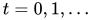，地区 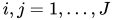。地区可以先定义为省份或若干地区组，空间精度取决于数据；不是先假设可取得每座城市的微观标识。
- 封闭的国内经济，允许地区间商品贸易和家庭迁移，暂不设国际迁移。
- 家庭包含一对同龄成年伴侣与未成年子女，联合决策。用 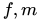 标记夫妻两名成年人；基准排除单身、离婚、异龄配偶及家庭分居。这些限制意味着基准不是中国全部家庭的精确人口模型。
- 20 岁形成新家庭；20–64 岁可劳动；20–44 岁可生育；85 岁退出。年龄边界只是基准计时设定，不是对中国法定退休、生育行为或死亡率的估计；后续需按数据和性别改写。
- 20 岁以前儿童不供给市场劳动；基准中儿童无死亡、成年人到退出年龄前无死亡，以便先完成队列记账。加入存活概率需要同时处理孤儿、丧偶和监护转移，不能只在总人口方程中随手乘一个存活率。
- 家庭不持有可交易资产，收入当期支出。固定住房、在位企业和托育容量的收益归一个全国公共资产基金，逐期等额分红给成年家庭。这是**显式的所有权闭合假设**，不是对中国实际产权的描述。加入家庭资产和住房所有权是扩展，不应在本版中暗称已经内生化储蓄。
- 商品生产使用固定数量的在位差异化企业；地区住房与托育容量先给定。动态来自家庭经验、迁移和人口队列，不依赖资本积累也可以形成动态空间一般均衡。本版不是对 KLR 全模型的复现。

### 2.2 家庭状态

期初家庭在地区 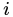，状态为

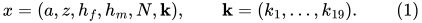

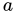 为夫妻年龄，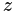 为固定家庭类型，包含教育／生育偏好等离散异质性；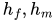 为夫妻经验相关效率；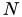 是累计已生孩子数；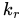 是当年满 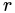 岁、尚随父母居住的子女数。不存在的年龄组合应从状态空间删除，不能允许 20 岁母亲已有 19 岁孩子等不可能状态。

用 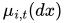 表示迁移前成年家庭的**数量测度**，不是强制和为 1 的人口份额。成年家庭总数为 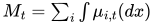。人口份额应由数量另行计算，不能在生育内生时固定全国总人口。

### 2.3 年内顺序

1. 给定期初家庭和子女年龄结构，以及全程可预见的政策／基本面路径；家庭观察迁移偏好冲击，选择本年居住地 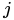，子女随迁。
2. 到达后观察生育偏好冲击，选择本年出生 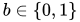、夫妻劳动、照料和消费；本年新生儿年龄为 0。
3. 商品、住房、托育、劳动市场和财政同时结算。第 1–3 步的价格是均衡价格，不能把迁移先算完再固定工资来声称一般均衡。
4. 到下一年，成年人和儿童各增加一岁；19 岁子女进入成年家庭形成池；85 岁成年人退出。

年度基准把受孕和出生压缩为一个计划选择，适于可预见路径；若研究意外政策公告的月度或当年效果，应新增“已孕”状态，并使受孕决定到出生经过孕期，不能让宣布当天立即产生可调整的新生儿。

## 3. 家庭的当期约束和效用

### 3.1 生育、育儿与工作时间

可行生育集合为

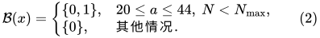

其中 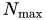 是数值状态上界或明确的政策限制，二者必须区分并检验数值上界是否约束结果。

本年受抚养孩子数量及照料需求为

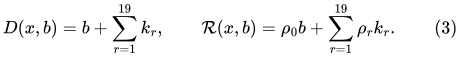

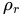 是每孩每年的照料时间；可允许幼儿较高，但具体数值待数据估计。父母照料 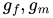 与购买托育服务 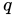 满足

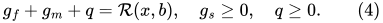

这一单位定义使一单位正规服务替代一单位家庭照料；二者质量差异和互补性暂不建模。基准不允许未成年子女留在原籍，因此不能直接研究留守儿童政策。

对 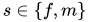，令 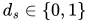 是就业选择、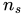 是市场工时、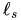 是闲暇，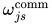 是就业所需通勤时间：

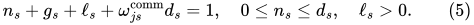

退休后固定 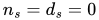。正的固定就业效用成本可产生劳动参与的广延边际；工时是集约边际，不能只建工时却把结果叫作劳动参与率。本版无失业和求职配给，最优解中的正工时参与与就业重合；现实数据的“是否工作”和标准劳动参与率仍须分别核对。

### 3.2 预算与房屋需求

家庭面对商品价格指数 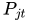、住房服务租金 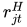、托育服务价格 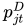、单位有效劳动工资 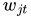。有效劳动收入为 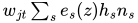；性别工资与技能差异先归入 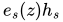，不额外建立歧视或失业搜索机制。

令 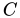 为一般家庭消费，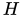 为租用住房服务，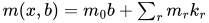 为特定儿童物质支出，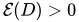 为消费等价规模；特定儿童支出不再重复计入 。令住房最低需求为 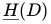，具有 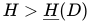。于是

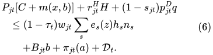

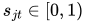 是按正规托育费用报销的比例，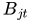 为每次出生现金补贴，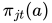 为退休等转移，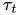 为全国工资税，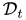 为资产基金分红。可将 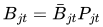、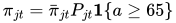，避免政策金额依赖任意价格单位；真实政策须另行编码资格、孩次和支付期限。

当期效用设为

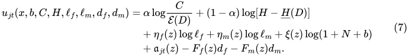

其中 ，。累计孩次带来暖光效用，孩子成年后仍有情感价值；本版不包含父母对孩子终身效用的递归利他、子女养老转移或孩子劳动收入归父母。公式是本文选择，不能称为某篇文献的原始效用函数。

住房最低需求使孩子产生真实的空间成本；否则只在效用中写“喜欢孩子”，住房渠道可能无法被清楚识别。最低住房也可能使部分状态—地区—生育组合不可行，对此应令其价值为 ，不能用负消费或负住房来强行求解。

### 3.3 经验与状态转移

夫妻效率按简化积累式演化：

子女和孩次转移为

 不再进入父母的受抚养向量，而进入下一期成年人口池。注意这里不是“”： 是累计生育数，不能因孩子离家而下降。20 岁成年与 85 岁退出的设置，使基准中所有可行生育者的子女在父母退出前成年。

## 4. 动态生育和迁移决策

给定所有未来均衡价格与政策，定义固定居住地 、固定出生  时的最优价值

受式（4）–（9）约束，。最后存续年龄的继续价值为零。 是下一期重新观察迁移冲击前的价值，因此家庭考虑孩子、经验和未来迁移机会。

令各生育选项的独立极值型偏好冲击具有尺度 ，各目的地冲击尺度为 ，均作中心化以移去不影响选择的常数。到达地区后的包容价值及生育概率为

家庭迁移的效用成本为 ，，例如在迁居时随幼儿人数上升。基准成本在**效用单位**计量，不是货币开支，不应在商品资源约束中再扣一遍。

这是一个**先居住地、后生育**的信息结构，两种极值冲击独立；不是将所有“地区 × 生育 × 工作”方案不加区别地放进一个 Logit。固定生育成本、就业成本以及偏好冲击使参与和生育都可以在家庭间异质。

若在计量上需要解释迁移与出生在同年内的反向时序，可另估“先怀孕后迁移”的替代时序；不能将该先后关系称为已识别的现实规律。有摩擦和异质性时，不同地区实际工资或居民效用无需相等。

## 5. 商品贸易、生产、住房和托育

### 5.1 CES 商品与垄断竞争

每个地区  有固定在位企业测度 ，企业对称，劳动生产率 。每一品种使用有效劳动，出厂价为

地区间冰山贸易成本 ，。CES 价格指数与从  采购的支出份额为

一般消费和儿童特定物质支出均购买同一 CES 组合。这是简化，未来可分教育、医疗和一般消费。

迁移后的家庭数量测度为

以下记 ；所有政策函数与连续控制都取式（10）中对应选项的最优值。地区商品支出、销售收入、生产劳动及利润满足

式（20）同时计入冰山运输所需生产； 是出厂销售收入。由于基准固定企业数量且无自由进入，企业有正利润；不能同时再施加“自由进入、利润为零”，除非增加固定成本和进入方程并改写资源分配。

### 5.2 住房市场

固定住房服务供给为 ：

租金  内生。迁入、家庭数及孩子数量上升可能推高租金，从而反馈于生育、居住与消费；方向和幅度须求解，不是一个不加条件的实证命题。本版无房屋购买、抵押或住房投资。

### 5.3 托育有真实资源成本和容量约束

地区托育服务使用有效劳动，生产率为 ，总需求为 。价格、劳动投入和容量互补条件为

 为稀缺托位的容量租金，归资产基金。基准用价格出清而非行政排队；若实际政策采用定价加配给，需改写为分配概率和排队机制。按费用补贴  与扩大托位  是两种不同政策；容量固定时加补贴可能主要推高稀缺价格，不能将名义补贴直接等同可用托育增加。

工资是两个部门共用的单位有效劳动工资，劳动市场为

所以“父母释放的劳动”与“托育吸收的劳动”必须分别报告；不能把前者全部记为可贸易品生产净增量。

## 6. 政府与资产收益的闭合

全国统一工资税为给定补贴、报销率和退休转移筹资，逐期预算为

税率内生求解，并要求 ；若某政策需要不可行税率，应报告该方案在基准筹资规则下不可行，不能截断税率后声称预算平衡。本版没有政府借债或其他外生免费资金。

公共资产基金持有住房、在位企业及托育容量，分红为

所有成年家庭每户领取同一名义分红，不随当期目的地改变。因新增成年家庭获得基金份额，本假设含再分配；正式版本应比较事前固定产权、地区所有权或家庭资产异质性。这里先把产权说清楚，比把租金和利润从经济中遗漏更重要。

将所有家庭预算相加，并使用式（21）–（26），得到总量核查关系

式（27）是闭合后的记账恒等式，不是额外独立的地区市场方程。补贴是转移支付，不是额外生产；托育劳动和冰山成本已在生产资源中计入。可取  作为逐期名义单位，并按式（6）的价格指数规则表达真实政策。

## 7. 人口与家庭形成：明确避免重复计数

### 7.1 新成年家庭的形成假设

令  为子女成年类型的外生转移核，。基准不内生化孩子教育；父母经验  与孩子成年技能类型不是同一个变量。

假设每个地区、每个成年类型的男女新成年人口各占一半，且同龄同类型完全配对；一对新人构成一户，初始效率为 ，。这是为避免另建婚配市场的强简化，不能据此研究性别失衡或结婚约束。

地区  下一期成熟子女人数为

新成年家庭数量为 ，出生地或童年居住地不固定其终身位置：他们下一期仍可按式（14）迁移。不能把每名成年孩子都当作一户双成人家庭，否则会把未来人口翻倍。

### 7.2 分布转移

以  表示式（8）–（9）的父母状态推进，则

随机经验等扩展时，将 Dirac 点质量换成相应条件转移核即可。当前年龄 84 的家庭本期仍消费、可迁移，期末退出，不进入下一期；式（28）应只在可行家庭状态上运算，基准末龄家庭已无未成年子女。

本年出生数与期初人口为

如  是退出家庭数，则必须满足

迁移不改变全国人口；子女成年只是从“父母受抚养人口”转为“新家庭成年人口”，不改变全国人数。式（31）是本版无提前死亡、无国际迁移的记账式，不可直接拿去拟合现实死亡率。

### 7.3 指标

分别计算地区夫妻就业率、女性工时、男性工时、、、、出生数、按女性年龄划分的生育概率、成年家庭迁入迁出、随迁儿童和劳动份额 。

本模型每户一名育龄女性，因此  除以相应育龄家庭数得到年生育率；总和生育率需累加年龄别率，不能把当年平均生育概率直接称为 TFR。家庭迁移率与人数加权迁移率也应分别报告。

## 8. 能从模型得到什么，以及不能预先断言什么

### 8.1 劳动与照料的边际条件

令  为名义预算乘子， 为一单位时间的效用影子价值。对内点、就业状态固定且  的解，有

其含义是少工作一小时不仅损失当前税后工资，还可能损失未来经验收益。固定就业成本下还需比较工作与不工作的离散价值，不能只使用式（32）。

如父母照料和正规托育都为内点，照料约束乘子  满足

这给出照料选择的机会成本逻辑，不能推导出“所有母亲一定照料、父亲一定工作”；分工取决于技能、偏好、固定成本和继续价值。

### 8.2 生育的真正决策条件

离散生育用  和式（12）决定。为解释机制，可暂把  连续化、固定其他离散状态，并在光滑内点下写出示意性包络条件：

式（34）是本文模型的局部解释式，不是已证明的全球生育比较静态，也不是用于整数  的求解条件。继续价值已经包括将来十九年的孩子支出和时间需求，不能再外加一遍同样的育儿成本现值。

### 8.3 政策效果不预设符号

| 政策／变化 | 直接渠道 | 均衡反馈与可能的抵消 |
|---|---|---|
| 增加出生现金补贴 | 降低净货币成本 | 税率上升、更多照料、住房拥挤；现金也可能支持一方减少工作 |
| 提高托育报销率 | 降低家庭自付价格 | 容量不足时容量租金上升，实际服务数量可能难以扩大 |
| 扩大托育容量 | 缓解服务稀缺 | 托育部门需吸收劳动；补贴与供给政策财政成本不同 |
| 更高生产率／工资 | 影响收入、迁入和商品价格 | 同时提高育儿机会成本、租金与未来预期，生育方向不确定 |
| 降低家庭迁移成本 | 改善地区选择机会 | 地区出生率变化可能来自家庭排序，而非原居民行为改变 |

当期新增出生没有直接增加成年人数，但可通过父母劳动、价格和迁移影响当期 。在本版计时下，时点  的新生儿到  才进入成年家庭池；新增成年人口是否提高有效劳动及哪个地区受益，仍取决于经验／技能、工作选择、迁移和均衡价格。

## 9. 均衡定义和数值求解

### 9.1 均衡

给定 、可行初始年龄结构、企业测度、住房、托育容量、政策与外生基本面路径，一条完全预见均衡路径包括：

- 价值函数、生育与迁移概率、各家庭选项的连续和参与决策；
- 工资、商品价格指数、住房租金、托育价格与容量租金；
- 商品支出及销售、部门劳动、财政税率和分红；
- 家庭测度、出生与成年队列。

它们同时满足式（2）–（29），以及一致预期、非负性和全部互补条件。式（31）、（27）用于核查。均衡允许  的群体、退休和不就业；不要求所有城市实际效用均等。

### 9.2 推荐算法

1. 先用两地区、少量类型和有限孩次搭建，再扩展至省际。保留年度年龄和孩子成年边界，不能为省状态维度而让出生当年成为劳动。
2. 给出价格、税率、分红的整条路径猜测，选择足够长模拟期及明确的终端延续规则。
3. 按日历期倒推和年龄倒推求式（10）–（14）；枚举居住地、出生和工作组合，对每个组合解连续消费—照料问题。使用稳定的 LogSumExp，避免指数上溢。
4. 从真实或合成初始测度向前推式（18）、（28）–（29）；汇总各市场需求、队列和财政。
5. 联立调整工资、租金、容量租金、税率与分红，使式（19）–（26）的归一化残差收敛；正变量可在对数域更新，容量条件用互补求解。对超预算、不可行状态、未收敛应显式报错。
6. 反复进行后向—前向迭代，检查价格、价值和分布路径；保存残差、迭代次数和对初值、网格的敏感性。

**终端不能随意设为零价值或固定人口。** 固定住房、内生人口增长下不自动存在平稳水平稳态或平衡增长路径。应先检查替代生育与资源增长是否相容；若尚无适当终端稳态，明确采用有限窗口加外推延续并延长窗口测试。政策实施末期附近的生育结果可能受到截断影响，不应用于主要结论。

本版也没有证明外层迭代是压缩映射；尤其引入集聚外部性、非凸参与和生育选择后，收敛和均衡选择需要实际检查。不能因 KLR 的特定结构有理论结果，就宣称本版自动存在唯一均衡。

## 10. 参数识别与论文实施优先级

先估计或构造：年龄别／孩次别出生概率、夫妻参与与工时、子女年龄的照料梯度、地区工资和房租、迁移流、实际托育供给及政策待遇。、、、偏好、育儿时间、经验积累、商品替代弹性等都要逐项标明“估计、校准、外部采用或敏感性”，本稿不填写伪造数值。

识别最困难的几项是：

- 偏爱孩子与生育成本可产生类似出生率，单凭地区平均出生率不足以分别识别；
- 地区舒适度与迁移成本可共同解释不迁移，需要额外迁移时序／距离／家庭状态变化；
- 工资差异、工作经验和生育偏好共同决定就业选择，需要动态面板及独立变化；
- 地方补贴可直接改变收入与迁移吸引力，因此不能无条件将其当作只影响生育的工具变量。

建议第一步估计政策对出生、劳动、迁移的约化式，再用这些结果作为结构验证或矩，而不是预先施加所有政策效应同号。完整方案见 [09_实施方案](09_模型文献依据与估计实施方案.md)。

### 10.1 城市观测值与初始条件

以下数值取自 `D:\毕业论文\原始数据\中国城市数据库v202603版（2000-2024年）.xlsx` 的「原始数据」工作表。选取深圳、成都和攀枝花作为同年口径的例子。数值按工作簿原列单位列示，括号为单元格。

| 城市 | 2020 年常住人口（万人） | 2020 年 GDP（万元） | 2020 年城镇非私营单位在岗职工平均工资（元／年） | 2024 年常住人口（万人） |
|---|---:|---:|---:|---:|
| 深圳 | 1,763（X4722） | 276,700,000（H4722） | 139,436（BM4722） | 1,799（X4726） |
| 成都 | 2,095（X5672） | 177,170,000（H5672） | 104,463（BM5672） | 2,147（X5676） |
| 攀枝花 | 121（X5722） | 10,410,000（H5722） | 原表空白（BM5722） | 122（X5726） |

2020 年深圳与成都同口径的观测年工资之比约为 1.335，可用于约束模型生成的相应样本年收入比。式（6）使用单位有效劳动工资，匹配年收入还需计入模型工时、效率与样本覆盖。常住人口用于式（30）的地区人口规模矩，初始化式（1）的家庭分布仍需年龄、家庭结构和孩次。GDP 可作为地区规模矩，式（15）的生产率还需在模型中反推。三城的所列两年出生人口单元格均为空白。粗出生率需要匹配同口径的出生人数和年平均人口。市级学前教育在校生与模型的 0–2 岁托育容量属于不同口径。

### 10.2 文献数值、政策输入及用法

| 模型对象 | 可核对数值 | 来源及定位 | 用法 |
|---|---|---|---|
| 生育水平 | 2020 年全国总和生育率 1.3，原文换算为每成年个体 0.65 | Xu 与 Pan（2025），PDF 第 10 页参数校准段及第 11 页表 2。[论文](https://doi.org/10.1016/j.econmod.2025.107206) | 全国生育水平的参考目标。用模型的年龄别生育率构造可比指标，结合模型双成人家庭及年龄范围说明覆盖差异。 |
| 育儿时间 | 原模型总育儿时间参数 0.12、私人部分 0.099、公共部分 0.021 | Xu 与 Pan（2025），PDF 第 10 页表 1 及校准段、第 11 页表 2。[论文](https://doi.org/10.1016/j.econmod.2025.107206) | 式（3）年龄别照料需求的数量级参考。要先统一时间单位，并用按儿童年龄分组的照料时长估计各年龄系数。 |
| 0–2 岁儿童支出及托育价格 | 原文以人均收入 36,000 元的城市为参照，年儿童支出 15,000 元，年托育价格 12,000 元，与祖辈同住时的有效价格设为 4,800 元。均为 2020 年价格 | Zhang, Wei（2026），*Paying for births in China: Staggered childbirth subsidies, maternal employment and the marginal value of public funds*，本地 SSRN 预印本，PDF 第 14 页表 4。[SSRN](https://doi.org/10.2139/ssrn.7607999) | 式（6）的费用量级参考。先拆分儿童支出与托育支出，避免重复计入，再把年度费用换算为每服务单位价格。4,800 元是原文对祖辈照料的校准值，可供祖辈扩展情景参考。 |
| 地方补贴的生育与母亲就业反应 | 对数一般生育率系数 ×100 为 4.14（标准误 0.64，对应约 4.23% 相对变化）；最小子女未满 3 岁母亲的就业率下降 1.71 个百分点（标准误 0.29），政策前均值 56.47% | Zhang, Wei（2026），同一 SSRN 预印本，PDF 第 15 页表 5。2016–2020 年为政策前时期，88 个实施城市与 198 个对照城市。[SSRN](https://doi.org/10.2139/ssrn.7607999) | 在复现政策覆盖与比较样本后，作为式（12）出生反应和式（24）家庭劳动反应的外部检验。一般生育率使用育龄女性作分母，须按原文定义构造。 |
| 全面二孩改革的就业反应 | 女性 −4.7 个百分点，老年家庭成员 +2.6 个百分点 | Dong 与 Li（2025），PDF 第 6 页表 2，因变量为是否工作。论文使用 CHFS 2011–2019 与 CFPS 2010–2020。[论文](https://doi.org/10.1016/j.econmod.2025.107345) | 改变生育资格情景的外部验证。老年反应适用于有祖辈劳动选择的扩展模型。 |
| 全国育儿补贴政策输入 | 2025 年方案的国家基础标准为每孩每年 3,600 元，发放至年满 3 周岁。完整 36 个月未折现合计 10,800 元 | 中共中央办公厅、国务院办公厅《育儿补贴制度实施方案》第二、三部分。[正式政策文本](https://www.beijing.gov.cn/zhengce/zhengcefagui/202507/t20250730_4161880.html) | 在年度模型中，简化为按合资格 0、1、2 岁儿童逐年支付。式（6）和式（25）应计入同一家庭年度支付额。精确复现时还应编码资格、发放时点和过渡期折算。 |

文中政策金额按原口径列示。联立求解前应把名义补贴、城市工资和以 2020 年价格报告的儿童支出换到同一基年。SSRN 预印本的地方补贴系数和 Dong 与 Li 的生育资格改革系数对应不同政策冲击，应分别检验。模型的折现因子、生育和迁移选择的尺度、地区迁移成本及分年龄照料系数留待估计。CFPS 原始文件可用于构造微观目标，本文使用的数值来自上述工作表、论文和政策文本。

## 11. 优先反事实及结果表应如何设计

至少比较：①现金补贴；②托育费用补贴；③新增托育容量；④现金与容量组合；⑤流动家庭同等待遇。比较同预算政策时，应计入均衡价格下的实际财政支出和筹资成本；若扩大容量需建设投入，还须补充容量投资方程和资源成本，不能只给  一个免费提高而称作同预算。

每个方案报告实施后各年：出生与年龄别生育、女性和男性参与、工时、部门有效劳动、家庭和人数迁移、租金、托育价格／数量、税率，以及成年队列开始进入后的劳动份额。暂不填入任何“中国提高多少”的百分比。

建议做三个机制关闭实验：关闭生育调整但保留劳动／迁移；关闭迁移但保留出生；固定价格做局部均衡对照。差异是条件反事实分解，存在交互与顺序依赖，不能把三项简单相加当作唯一因果分解。

## 12. 可选扩展与不得混写的内容

| 扩展 | 需要额外增加的方程／状态 | 本版尚不能回答的内容 |
|---|---|---|
| 祖辈照料 | 亲属链接、祖辈时间与劳动、健康和跨户转移 | 不能把某个外生照料折扣当作祖辈劳动已内生化 |
| 户籍与公共服务资格 | 原籍、居住年限、资格转移规则 | 本版默认居住家庭同等资格；政策歧视需另加 |
| 孕期与出生风险 | 已孕状态、受孕与活产概率 | 意外公告的短期出生效应 |
| 子女教育与质量 | 逐子女累计教育、技能生产与教育资源成本 | 当前  外生，不能宣称已研究数量—质量内生权衡 |
| 储蓄和住房所有权 | 家庭资产、借贷约束、产权与遗产／基金份额 | 储蓄、购房、养老转移和金融市场 |
| 资本／住房投资 | 投资主体预算、资本积累、回报和 Euler 条件 | 本版固定供给；不能称资本调整已内生 |
| 集聚和生产率 | 外部性函数及识别、地区创新或技术扩散 | 本版  外生，不预设生育改变 TFP |
| 婚配、死亡与离婚 | 两性人口、配对、丧偶与监护转移 | 全人口预测与性别比影响 |

以资本扩展为例，仅写  不够；还要指定谁拥有资本、投资用什么商品、如何融资、未来回报如何进入最优条件，并把资本收益纳入式（6）或资产部门预算。初稿先完成较小基准，再选择与数据、研究问题最相关的扩展。

**可供论文概括的模型定位：** 一个具有异质双成人家庭、年度离散生育与劳动参与、连续工时及照料选择的生命周期空间均衡框架，通过商品贸易、住房、托育资源和全国财政联立，区分当期家庭劳动调整与出生队列成年后的劳动力空间再配置。这是待估计和检验的理论方案，不是已经得到的中国政策效果。
