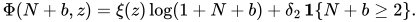

# 生育动机文献与模型扩展

整理日期为 2026-11-12。下列八篇来自用户提供的分享对话，书目信息、方法与结论按所列原文或作者摘要核对。文献中的样本数和比例保留原口径。模型与数据接口见 [08 家庭效用](08_生育与劳动力供给的动态空间一般均衡模型.md) 和 [09 估计方案](09_模型文献依据与估计实施方案.md)。

## 中国研究

### M01　盛禾、李建新（2023）

《生育动机的世代与性别差异分析——基于CFPS2020数据》，《社会》43(3)，187–212。核对期刊全文第三、四节及表 1–2。

- **研究问题与数据**　为何生养子女，以及生育动机如何随出生世代和性别而异。CFPS 2020 有效分析样本为 18,477 人，采用九项子女价值题项。
- **方法**　标准化题项后使用 K-means 聚类，以多项 Logistic 回归比较不同世代和性别的动机类型分布。
- **主要结论**　表 2 中，低意愿与消极、个体导向为主、双导向情感型、家庭导向为主四组分别占 8.85%、22.81%、14.75%、53.59%。80 后、90 后的个体导向更常见，男性总体更偏家庭导向。单期比较中的出生世代与年龄相互关联，解释时须考虑生命周期和既往生育经历。
- **用于本论文**　提供分组和问卷测量方案。表 2 百分比对应原研究受访者，估计样本应按育龄范围、家庭结构和相应权重重新计算。 [期刊全文](https://www.society.shu.edu.cn/CN/article/downloadArticleFile.do?attachType=PDF&id=19731)

### M02　宋健、胡波（2022）

《中国育龄人群的生育动机与生育意愿》，《人口与经济》第 6 期，1–16。核对作者摘要。

- **研究问题与数据**　考察生育动机与生育意愿的关系。使用中国人民大学人口与发展研究中心 2021 年组织的全国代表性抽样调查，以 20–49 岁妻子为主，丈夫样本作参照。
- **方法**　用自我决定论的动机连续统区分自主和受控动机，并考察情感效用、经济及时间照料成本等维度与意愿的关联。摘要可核到概念框架和关联结果，回归规格与有效样本数待全文确认。
- **主要结论**　内在动机与情感效用受到较强认同。自主和受控动机均与较强生育意愿相关，自主动机的关联更强。
- **用于本论文**　支持把情感价值与经济、时间和照料成本分开测量。问卷中的成本担忧可用于辅助解释已有成本渠道。 [文摘索引](https://www.sinomed.ac.cn/article.do?ui=2023145990) · [作者摘要全文](https://guoyanwang.clcn.net.cn/DRCNet.Mirror.Documents.Web/DocSummary.aspx?DocID=6781532&leafID=23253)

### M03　Su-Russell 与 Sanner（2023）

*Chinese Childbearing Decision-Making in Mainland China in the Post-One-Child-Policy Era*. *Family Process*, 62(1), 302–318。核对期刊中英文摘要。

- **研究问题与数据**　辽宁省 117 位已育两个孩子的母亲报告初育和二孩生育的原因，头胎年龄不超过 8 岁。
- **方法**　对开放式回答做归纳主题分析，对照同一批母亲报告的一孩和二孩理由。
- **主要结论**　两次生育的动机有差异。谈及二孩时，受访者考虑兄弟姐妹的长期利益和未来共同照料老人。研究样本为已育二孩者，解释集中在这些家庭的决策经历。
- **用于本论文**　为检验第二个孩子的独立偏好项提供机制依据。估计其大小需要同时观察生育与未生育二孩的一孩家庭。 [期刊摘要与 DOI](https://doi.org/10.1111/famp.12772)

### M04　靳永爱、沈小杰（2022）

《中国城市地区女性社会经济地位、生育动机与二孩生育计划》，《人口研究》46(6)，88–102。核对期刊摘要。

- **研究问题与数据**　用 2017 年“生育新政下中国家庭的生育决策”调查，研究城市女性社会经济地位、动机与二孩计划的关系。
- **方法**　用 KHB 分解考察生育动机在社会经济地位与二孩计划关系中的中介作用。
- **主要结论**　个体价值取向与二孩计划呈负相关，子女发展取向呈正相关。两类动机均有部分中介作用，子女发展取向的中介关联更强。
- **用于本论文**　提示不同维度与二孩计划的关联可以方向相反。该文的个体价值取向与 M01 的个体导向须按各自题项解释，估计时保留各自口径。 [期刊摘要与全文入口](https://rkyj.ruc.edu.cn/CN/Y2022/V46/I6/88)

## 国际研究

### M05　Miller（1995）

*Childbearing Motivation and Its Measurement*. *Journal of Biosocial Science*, 27(4), 473–487。核对作者摘要与 PubMed 扩展摘要。

- **研究问题与数据**　以美国加州圣克拉拉 401 对已婚夫妇为样本，其中 200 对未育、201 对已育一孩，考察生育动机的测量。
- **方法**　构建 Childbearing Questionnaire（CBQ），区分正、负两类生育动机，报告九个子量表及信度和效度证据。
- **主要结论**　生育动机可以通过多个题项测量。理论上动机先影响愿望与意愿，再与行为相联系。
- **用于本论文**　支持分别记录动机问卷、意愿和随后出生，问卷得分可作为分组指标。 [作者摘要](https://pubmed.ncbi.nlm.nih.gov/7593054/) · [DOI](https://doi.org/10.1017/S0021932000023087)

### M06　Nauck 与 Klaus（2007）

*The Varying Value of Children: Empirical Results from Eleven Societies in Asia, Africa and Europe*. *Current Sociology*, 55(4), 487–503。核对期刊摘要。

- **研究问题与数据**　使用 2002–2003 年 Value of Children（VOC）复查调查，比较包括中国在内的 11 个社会中不同年龄组的子女价值。
- **方法**　比较总体及分社会的因子结构，检查量表内部一致性，并对文化间的应答风格差异作调整。
- **主要结论**　可区分生活支持、社会评价和情感价值三个维度。情感价值在各社会普遍较高，生活支持和社会评价的差异更明显。
- **用于本论文**　支持区分问卷维度，并在跨群体比较前检验题项可比性。 [期刊摘要与 DOI](https://doi.org/10.1177/0011392107077634)

### M07　Rijken 与 Knijn（2009）

*Couples’ Decisions on Having a First Child: Comparing Pathways to Early and Late Parenthood*. *Demographic Research*, 21, 765–802。核对期刊摘要及全文入口。

- **研究问题与数据**　从 Netherlands Kinship Panel Study 选取 33 对荷兰伴侣，比较较早和较晚初育的决策过程。
- **方法**　采用半结构式访谈和定性比较。
- **主要结论**　两组初育决策都常以隐含方式形成，伴侣意见不一致时也未必展开讨论。部分与推迟生育有关的特征，未必进入当事人的有意识权衡。
- **用于本论文**　把配偶答案作为家庭偏好的补充信息。夫妻议价模型需要双方偏好和家庭决策数据。 [期刊页面与全文](https://www.demographic-research.org/articles/volume/21/26)

### M08　Schoen、Astone、Kim、Nathanson 与 Fields（1999）

*Do Fertility Intentions Affect Fertility Behavior?* *Journal of Marriage and Family*, 61(3), 790–799。核对期刊书目与作者摘要。

- **研究问题与数据**　美国 National Survey of Families and Households 两轮均接受访谈的 2,812 名非西班牙裔白人，考察初次访谈的意愿对后续出生的预测。
- **方法**　纵向关联分析，控制背景和生命历程变量，并比较意愿的确定程度与期望生育时间的预测表现。
- **主要结论**　基期意愿越确定，越能预测后续生育。期望时间的预测关联较弱且偏短期。结论对应原研究的美国样本。
- **用于本论文**　以中国追访中的实际出生验证意愿与动机的预测能力。 [期刊书目与 DOI](https://doi.org/10.2307/353578) · [作者摘要](https://pure.johnshopkins.edu/en/publications/do-fertility-intentions-affect-fertility-behavior-4/)

## 采用现有家庭偏好项，检验孩次扩展

现有模型的暖光项已用固定家庭类型区分对子女的偏好强度。估计时，可先用有题项资料的家庭检验动机分组能否改善对实际出生的预测。若一孩与二孩的出生率仍无法由现有偏好曲率和已测量的照料、住房及货币成本共同拟合，可增加一个二孩的持续效用增量。

这里，累计孩次达到 2 时，每期子女效用增加一个共同的偏好参数。对已有一孩的家庭，当期再生育会触发这项效用，未来的效用也通过继续价值计入。首胎可通过未来获得二孩的机会受到间接影响。将新增参数置零即可回到基准模型。它只进入家庭效用与继续价值，随后经出生概率、家庭照料和迁移决策影响劳动力与空间均衡。若只看到一孩与二孩的平均出生率差，额外偏好与额外养育成本仍可能混淆。原有的整数出生决策式（10）–（14）可直接使用，式（34）的光滑近似适用于基准项。

估计顺序是先让已有固定家庭类型吸收可测量的动机异质性，再检验上述一个新增参数。只有各动机组的出生事件和成本数据均能支撑估计时，才检验二孩增量是否随动机变化。地方规范、养老转移、夫妻议价和子女质量都需要独立数据和相应的行为方程。

## 本地数据与实施条件

1. 已核对本地 CFPS 2020 压缩包的文件清单。包内有个人库 `cfps2020person_202306.dta` 和家庭关系库 `cfps2020famconf_202306.dta`，内层数据文件加密。本次核查到文件清单、官方问卷和文献汇总值，实际样本尚未构造。
2. CFPS 2020 个人自答问卷第 148 页的 ME201–ME209 是子女价值题组，问卷中适用年龄为大于 21 岁。正式取数时按数据字典核对字段名、应答来源、跳题、缺失和权重。原始编码中 5 是中性回答，若按同意程度递增赋分，须核对标签后按 4、3、5、2、1 的顺序映射为 1 至 5。用盛禾、李建新表 2 的聚类作可比参照，再针对模型覆盖人群重新计算。双答家庭可比较妻子口径与夫妻题项合成口径，报告配偶缺答造成的样本选择。 [CFPS 2020 官方问卷，第 148 页](https://www.isss.pku.edu.cn/cfps/docs/20230629111959565639.pdf#page=148)
3. 用 2020 年访谈时点的个人标识匹配 2022 年本人及家庭关系记录，以访谈日期及子女出生日期确定区间内新增出生。分别在期初未育和期初已育一孩的风险集中构造转入一孩、二孩的概率，报告失访和日期缺失，并明确两轮区间概率与 08 年度模型的换算。迁移须按政策发生前后及可用的地理层级核对。后续出生可检验预测能力，仍需考虑已育经历反过来影响 2020 年态度。
4. 联合使用年龄别与孩次别实际出生、照料或支出、父母工时及工资约束偏好和成本。若有合格的外生政策变化，可另用符合资格人群的出生和劳动响应约束成本渠道。按出生时点或独立追访留样本验证。现阶段文献中的分类比例、计划关联和国外结果均仅作外部参照。暖光偏好及二孩增量尚无估计值。
